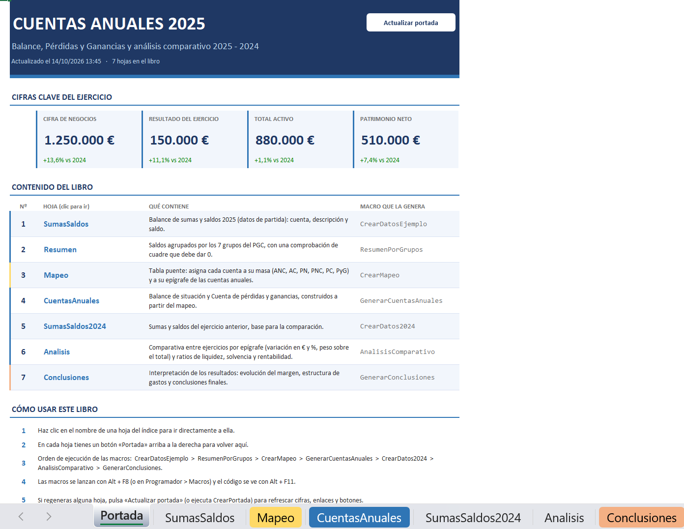
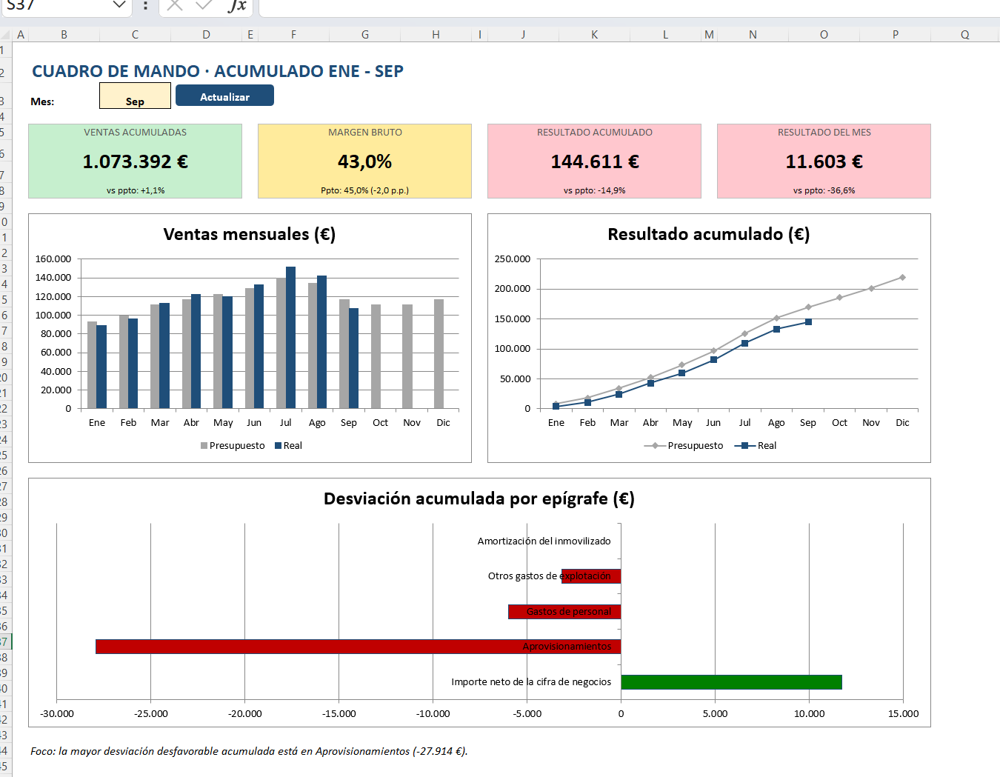

# VBA para controller financiero y FP&A

Dos proyectos en Excel VBA que automatizan tareas habituales de un puesto de **controller financiero** o **FP&A**: desde la exportación contable del ERP hasta los estados financieros y su análisis, y el control presupuestario mensual con cuadro de mando e informe de gestión.

*Two Excel VBA projects automating typical financial controlling and FP&A tasks: financial statements and ratio analysis from an ERP trial balance, and monthly budget-vs-actual reporting with a KPI dashboard.*

## Proyectos

### 1. [Cuentas anuales](cuentas-anuales)

Del balance de sumas y saldos del ERP al balance y la cuenta de pérdidas y ganancias con formato PGC, análisis comparativo de dos ejercicios, ratios y conclusiones redactadas automáticamente.

**Claves**: tabla de mapeo de cuentas, análisis horizontal y vertical, ratios de liquidez, solvencia y rentabilidad, conciliación de la caja.

### 2. [Control presupuestario](control-presupuestario)

Real frente a presupuesto con desviaciones y semáforo, cuadro de mando con KPI y gráficos, informe de gestión automático con puente del resultado (efecto volumen y precio) y previsión de cierre.

**Claves**: desviaciones mensuales y acumuladas, presupuesto flexible, forecast, cuadro de mando que se actualiza con un clic.

## Qué demuestran

- **Automatización de reporting**: estados financieros, análisis e informes que se regeneran con una macro.
- **Controles de calidad** integrados: cuadres, cuentas sin mapear, validación de lo que introduce el usuario.
- **Separación de datos, lógica y presentación**: mapeos y parámetros en hojas o constantes, no escritos dentro del código.
- **Interpretación financiera**: las macros no solo calculan, también redactan las conclusiones con las cifras.

Cada proyecto tiene su propio README, el libro `.xlsm` listo para descargar y el código de los módulos en `src/`.

## Sobre el repositorio

Proyectos de aprendizaje de VBA desarrollados paso a paso con ayuda de IA (Claude). Todos los datos son ficticios.
