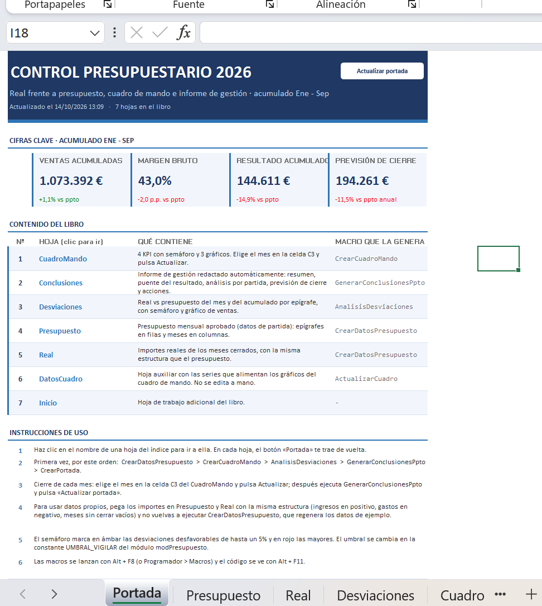
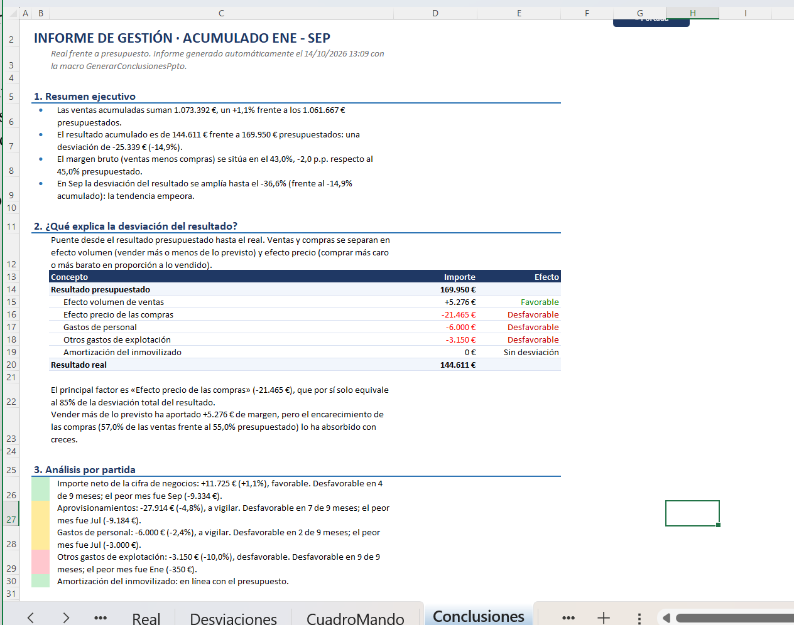

# VBA Budgeting · Control presupuestario automatizado en Excel

Libro de Excel con macros VBA que automatiza el **control presupuestario mensual** de una empresa: compara real frente a presupuesto, calcula desviaciones con semáforo, construye un **cuadro de mando** que se actualiza con un clic y **redacta solo el informe de gestión** del acumulado, incluida la previsión de cierre del ejercicio.

*Automated budget-vs-actual reporting in Excel VBA: variance analysis, KPI dashboard, volume/price bridge, year-end forecast and an auto-written management report.*

## Qué hace

| Hoja | Contenido | Macro |
|---|---|---|
| **Portada** | Cifras clave, índice con enlaces a cada hoja e instrucciones de uso | `CrearPortada` |
| **CuadroMando** | 4 KPI con semáforo y 3 gráficos. El mes se elige en un desplegable y se actualiza con un botón | `CrearCuadroMando` / `ActualizarCuadro` |
| **Conclusiones** | Informe de gestión redactado automáticamente a partir de las cifras | `GenerarConclusionesPpto` |
| **Desviaciones** | Real vs presupuesto del mes y del acumulado por epígrafe, con semáforo | `AnalisisDesviaciones` |
| **Presupuesto / Real** | Datos de partida: epígrafes en filas y meses en columnas | `CrearDatosPresupuesto` |
| **DatosCuadro** | Series auxiliares que alimentan los gráficos | `ActualizarCuadro` |

### Cuadro de mando

### Informe de gestión automático

El informe se escribe solo, con las cifras del periodo elegido:

1. **Resumen ejecutivo**: ventas, resultado y margen bruto frente al presupuesto, y tendencia del último mes.
2. **Puente del resultado**: del resultado presupuestado al real, separando **efecto volumen** (vender más o menos) y **efecto precio** de las compras (presupuesto flexible). Incluye un control que comprueba que el puente cuadra al euro.
3. **Análisis por partida**: semáforo, número de meses desfavorables y peor mes de cada epígrafe.
4. **Previsión de cierre** en dos escenarios: cumplimiento del presupuesto pendiente, o mantenimiento del sobrecoste actual de compras.
5. **Puntos de acción**, que solo aparecen si se detecta el problema correspondiente.

## Cómo probarlo

1. Descarga [`Control-presupuestario.xlsm`](Control-presupuestario.xlsm) (botón **Download raw file**).
2. Windows bloquea las macros de los archivos descargados de internet: clic derecho sobre el archivo → **Propiedades** → marca **Desbloquear** → Aceptar.
3. Ábrelo, pulsa **Habilitar contenido** y sigue las instrucciones de la hoja **Portada**.

Para regenerar todo desde cero, ejecuta con **Alt + F8**, por este orden:
`CrearDatosPresupuesto` → `CrearCuadroMando` → `AnalisisDesviaciones` → `GenerarConclusionesPpto` → `CrearPortada`.

Requiere Excel para Windows (probado en Microsoft 365).

## Estructura del código

El código de cada módulo está exportado en la carpeta [`src/`](src), para poder leerlo sin abrir Excel. Para usarlo en otro libro: editor de VBA (Alt + F11) → **Archivo → Importar archivo**.

| Módulo | Función | Técnicas VBA que utiliza |
|---|---|---|
| `Mod1Utilidades` | Funciones comunes: crear hojas y comprobar si existen | Control de errores con `On Error`, funciones reutilizables |
| `Mod2Presupuesto` | Datos de ejemplo y análisis de desviaciones del mes y el acumulado | `InputBox` con validación, `Public Const` para el umbral del semáforo, `ElseIf`, gráficos con `ChartObjects` |
| `Mod3CuadroMando` | Cuadro de mando con KPI, desplegable, botón y gráficos | Validación de datos y botones por código, gráficos enlazados a una hoja de datos, `Application.Match`, formato por puntos de gráfico |
| `modConclusiones` | Informe de gestión redactado automáticamente | Texto dinámico, `Collection`, parámetros `ByRef`/`ByVal`, descomposición volumen/precio, previsión |
| `modPortada` | Portada con cifras clave, índice e instrucciones | Diccionarios (`Scripting.Dictionary`), hipervínculos, formas con macro asignada |

### Principios de diseño

- **Separar datos, lógica y presentación**: los gráficos se crean una vez enlazados a una hoja auxiliar; actualizar es solo cambiar números.
- **Controles de calidad**: validación de lo que introduce el usuario, comprobación de que existen las hojas y de que el puente del resultado cuadra.
- **Sin cifras escritas a mano**: todo el texto del informe y de la portada se calcula a partir de los datos, así que se actualiza al cambiar el mes o los importes.
- **Parámetros en un solo sitio**: el umbral del semáforo es una constante (`UMBRAL_VIGILAR` en `Mod2Presupuesto`, 5 % por defecto).

## Conceptos de FP&A aplicados

- Análisis de desviaciones real vs presupuesto, mensual y acumulado, con criterio de signos homogéneo (desviación positiva = favorable).
- **Presupuesto flexible**: separación de la desviación de compras en efecto volumen y efecto precio.
- Margen bruto y su evolución en puntos porcentuales.
- **Forecast** de cierre: real acumulado + presupuesto pendiente, con un escenario alternativo.

## Sobre el proyecto

Proyecto de aprendizaje de VBA aplicado a tareas de controller financiero y FP&A, desarrollado paso a paso con ayuda de IA (Claude): diseño de las macros, depuración de errores e interpretación de los resultados. Los datos son **ficticios** y se generan con la macro `CrearDatosPresupuesto`.
