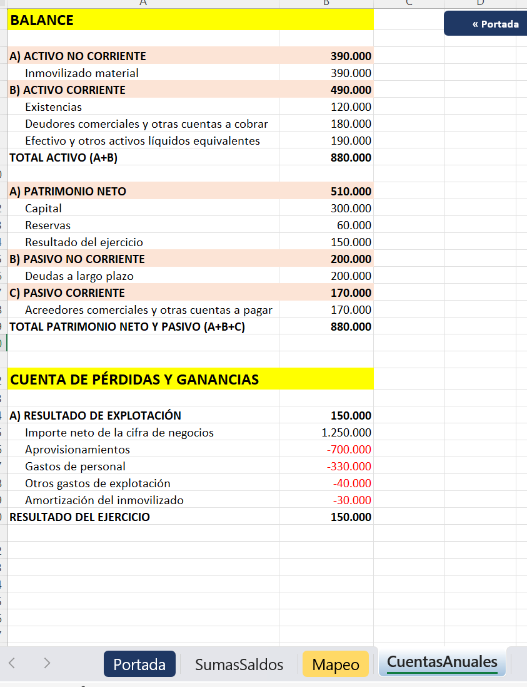
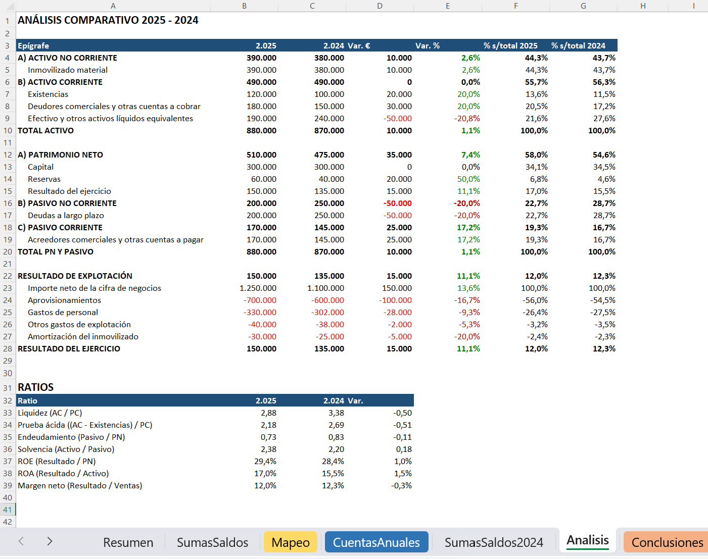
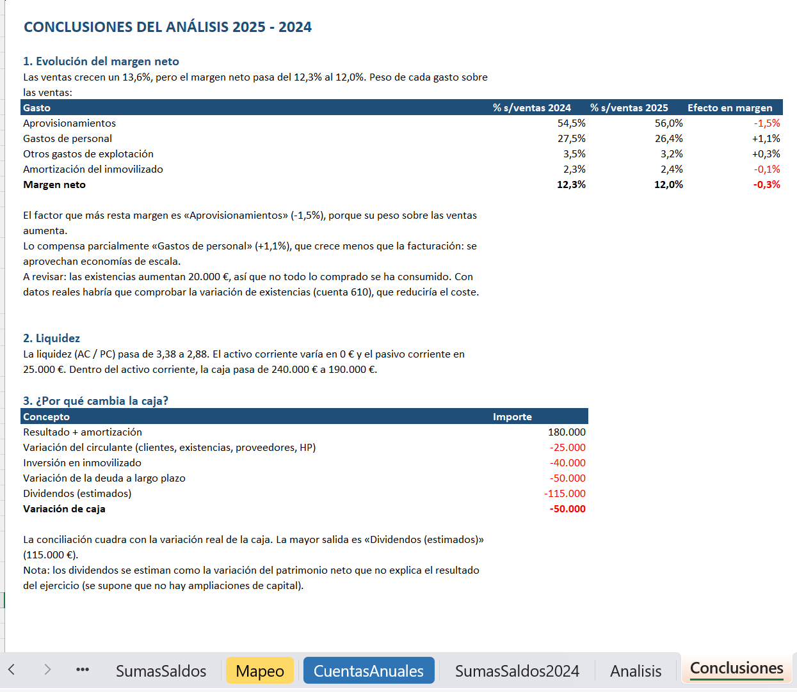

# Cuentas anuales · De la exportación del ERP al análisis financiero en Excel VBA

Libro de Excel con macros VBA que convierte un **balance de sumas y saldos** (la exportación típica de un ERP) en **balance y cuenta de pérdidas y ganancias** con el formato de las cuentas anuales del PGC, compara dos ejercicios, calcula los ratios principales y **redacta las conclusiones** del análisis, incluida una conciliación de la caja.

*Excel VBA workflow from an ERP trial balance to formatted financial statements (Spanish GAAP), year-over-year analysis, ratios and auto-written conclusions.*

## Qué hace

| Hoja | Contenido | Macro |
|---|---|---|
| **Portada** | Cifras clave, índice con enlaces a cada hoja e instrucciones de uso | `CrearPortada` |
| **SumasSaldos** | Balance de sumas y saldos del ejercicio (datos de partida): cuenta, descripción y saldo | `CrearDatosEjemplo` |
| **Mapeo** | Tabla puente que asigna cada cuenta a su masa patrimonial y a su epígrafe | `CrearMapeo` |
| **CuentasAnuales** | Balance de situación y cuenta de pérdidas y ganancias | `GenerarCuentasAnuales` |
| **SumasSaldos2024** | Sumas y saldos del ejercicio anterior, para comparar | `CrearDatos2024` |
| **Analisis** | Análisis horizontal y vertical de los dos ejercicios y cuadro de ratios | `AnalisisComparativo` |
| **Conclusiones** | Interpretación redactada automáticamente: margen, liquidez y conciliación de la caja | `GenerarConclusiones` |

### Balance y cuenta de pérdidas y ganancias

### Análisis comparativo y ratios

### Conclusiones automáticas

## Cómo funciona

1. **Datos de partida**: un sumas y saldos con criterio de signos homogéneo (saldo deudor en positivo, acreedor en negativo).
2. **Mapeo**: cada cuenta (por sus tres primeros dígitos) se asigna en una hoja a su masa (ANC, AC, PN, PNC, PC o PyG) y a su epígrafe. Si aparece una cuenta nueva, se añade una fila al mapeo, **sin tocar el código**.
3. **Estados financieros**: la macro acumula los saldos por epígrafe, calcula el resultado del ejercicio y lo lleva al patrimonio neto.
4. **Análisis**: variaciones en euros y en %, peso de cada epígrafe sobre el total activo o sobre las ventas, y ratios de liquidez, endeudamiento, solvencia y rentabilidad (ROE, ROA, margen neto).
5. **Conclusiones**: detecta qué gasto resta más margen y cuál lo compensa, y explica la variación de la caja (resultado, circulante, inversión, deuda y dividendos estimados).

### Controles de calidad

- El sumas y saldos debe **cuadrar** (suma total igual a 0).
- Ninguna cuenta puede quedar **sin mapear**: si ocurre, la macro se detiene y dice cuáles son.
- El balance debe cumplir **activo = patrimonio neto + pasivo**.
- La conciliación de la caja debe coincidir con la variación real del efectivo.

## Cómo probarlo

1. Descarga [`Cuentas-anuales.xlsm`](Cuentas-anuales.xlsm) (botón **Download raw file**).
2. Windows bloquea las macros de los archivos descargados de internet: clic derecho sobre el archivo → **Propiedades** → marca **Desbloquear** → Aceptar.
3. Ábrelo, pulsa **Habilitar contenido** y sigue las instrucciones de la hoja **Portada**.

Requiere Excel para Windows (probado en Microsoft 365).

## Estructura del código

El código de cada módulo está exportado en la carpeta [`src/`](src). Para usarlo en otro libro: editor de VBA (Alt + F11) → **Archivo → Importar archivo**.

| Módulo | Función | Técnicas VBA que utiliza |
|---|---|---|
| `Mod2Base` | Utilidades comunes, datos de ejemplo y resumen por grupos del PGC con control de cuadre | Arrays, bucles `For`, `On Error` controlado, funciones reutilizables |
| `Mod3CuentasAnuales` | Tabla de mapeo y generación del balance y la PyG | Diccionarios (`Scripting.Dictionary`), parámetros `ByRef`, signo de presentación como parámetro |
| `Mod4Analisis` | Análisis horizontal y vertical, ratios y conclusiones | Funciones que devuelven objetos, formato condicional por código, texto dinámico, `Const` |
| `Mod5Portada` | Portada con cifras clave, índice e instrucciones | Hipervínculos, formas con macro asignada, `Find` sobre rangos |

El primer módulo del aprendizaje (`Mod1Ratios`, que calculaba ratios leyendo celdas de una hoja fija) se retiró al quedar sustituido por `AnalisisComparativo`.

## Sobre el proyecto

Proyecto de aprendizaje de VBA aplicado a tareas de controller financiero, desarrollado paso a paso con ayuda de IA (Claude): diseño de las macros, depuración de errores e interpretación de los resultados. Los datos son **ficticios** y se generan con las macros `CrearDatosEjemplo` y `CrearDatos2024`.
